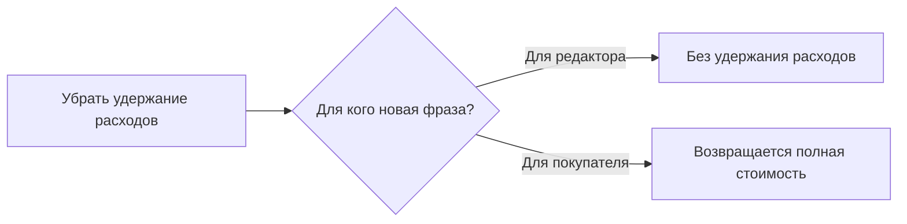

# Следы обсуждения в готовом тексте: оферта

Статус: `current`. Дата: 21.10.2026. Владелец: `platform.content`.
Применение раздела 10 `../writer-contract-v1.md`; не второй свод правил.

## Что уже было и почему повторилось

В каноне уже были требования «Не спорить с удалённой редакцией: читатель её
не видел» и «Не переносить в публикацию разговор редакторов». В
`calories-masterclass-neuroslop.md` сохранены прежние примеры: объяснение после
«550 ккал (только завтрак)», оправдание шутки о бургерах и возражение про
фрукты и хлеб после удаления исходного тезиса.

В локальном черновике оферты ассистент применил замечание как замену слов:
«за вычетом расходов» → «без удержания расходов». Проверки отдельного
абзаца глазами первого читателя не было. Общий принцип остался привязан к
учебным примерам и не был применён к юридическому тексту. Это ошибка
применения существующего правила, а не отсутствие пожелания владельца.
Рассинхронизация установленного skill с каноном обнаружена отдельно;
данных, что именно она вызвала эту фразу, нет.

## Реальный пример 21.10.2026

| Шаг | Текст / решение | Чья задача решается |
|---|---|---|
| Старая версия | Возврат за вычетом понесённых расходов | Прежнее условие |
| Замечание Сергея | Убрать удержание, возвращать 100% | Задание редактору |
| Ошибочная правка | Полная сумма без удержания расходов | Отчёт о выполнении задания внутри оферты |
| Готовая формулировка | До первого открытия материалов четвёртого дня Мастер-класса по запросу Заказчика возвращается полная стоимость Мастер-класса. | Действующее правило для покупателя |

## Другие случаи

| Происхождение | След обсуждения | Достаточный текст |
|---|---|---|
| Реальная история этого чата: срок доступа | После этого доступ автоматически не закрывается | Затем доступ в текущем личном кабинете сохраняется при наличии технической возможности. |
| Реальная история: публикация отзывов | Покупка не даёт права публиковать отзыв | Публикация отзыва согласовывается в личной переписке. |
| Реальный прежний случай, Калории | 550 ккал (только завтрак). Не записывайте это как калорийность всего дня. | 550 ккал (только завтрак). |
| Учебный пример: отмена требования отчёта | Пришлите дневник. Отдельный отчёт теперь не нужен. | Пришлите дневник. |
| Учебный пример: замена канала связи | Напишите в Telegram. Писать на почту не требуется. | Напишите в Telegram. |
| Учебный пример: срок ответа | Ответ придёт в течение двух дней, а не пяти, как раньше. | Ответ придёт в течение двух дней. |

Примеры в таблице сокращены для обучения; они не являются полными условиями
оферты или разрешением менять другие тексты.

## Контрграницы

«Без регистрации» может быть полезной характеристикой реального способа
входа; «не является медицинской услугой» обозначает предмет услуги.
Такие фразы сохраняются по функции. Удаляется не слово «без» или «не»,
а зависимость готового текста от невидимого читателю обсуждения.

## Проверка применения

При следующей адресной правке показать владельцу готовый абзац и отдельно
объяснение изменения. В проверке качества назвать функцию каждой новой
оговорки. Проверки ссылок, HTML и программы не доказывают выполнения этой
смысловой проверки. Нельзя обещать, что наличие правила исключает все будущие
ошибки; требуется применять проверку при каждом таком изменении.
