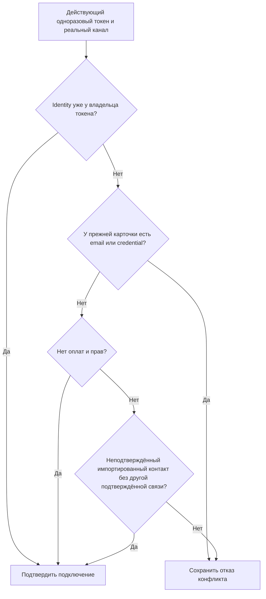

# Связь участника мастер-класса с мессенджером

Создаёт короткоживущие безопасные ссылки Telegram и MAX для привязки участника
к единому `user_id`. Вход в личный кабинет после покупки выдаётся по email и от
подключения мессенджера не зависит.

## Функции

- проверять доступ к мастер-классу до создания ссылки;
- одноразово связывать messenger account с внутренним user_id;
- создавать 15-минутную одноразовую ссылку `link_account` отдельно для Telegram
  и MAX из обязательного материала первого дня;
- разрешать привязать оба мессенджера, первый связанный делать основным, а затем
  позволять владельцу аккаунта явно менять основной канал без отвязки контактов;
- подтверждать обязательный материал серверным состоянием реальной связи, а не
  одним нажатием кнопки;
- для явной кнопки «Отправить в Telegram/MAX» создавать `named_delivery`: если
  канал ещё не связан, переход сначала связывает его, затем выполняет исходную
  отправку ровно один раз;
- направлять автоматические учебные, технические и маркетинговые сообщения только
  в точную основную messenger identity; молча переключаться на другой канал нельзя;

## Граница

Не помещает email, user_id, пароль или цены в ссылку. Токен хранится только как
SHA-256 hash. Legacy-purpose `account_credentials` сохраняется для уже созданных
бесплатных регистраций, но не участвует в новой платной покупке.

## Источники истины

`messenger_link_tokens`, Masterclass API и Telegram consumer.

Технические файлы, routes, таблицы, migrations и программные символы не
перечисляются вручную в карточке: они подставляются из generated inventory.

## Общий блок подключения

`messenger-connection.mjs` предоставляет одни и те же элементы подключения
Telegram/MAX и выбора основного канала для курса и окна отправки силового журнала.
Тексты курса и управление его прогрессом остаются в оболочке курса. Приложение
использует свою авторизацию профиля через действия Strength API, после которой
вызывает те же серверные функции создания токена и выбора основной связи.
Ни email, ни клиентское название платформы не определяют владельца токена.

## Конфликт со старой импортированной карточкой

Общая проверка Telegram/MAX различает подтверждённый кабинет и импортированный
контакт. Историческая оплата или право сами по себе не подтверждают привязку канала.
Ссылка по-прежнему одноразовая, ограничена платформой и сроком действия; инициатор
доказывает владение каналом настоящим событием мессенджера.

| Состояние прежней карточки | Результат |
|---|---|
| Есть email или credential | Отказ переноса связи; нужен разбор владельцем |
| Нет email, credential, оплат и прав | Прежний путь подключения контакта бота |
| Импортированный контакт без email/credential; источник google_clients_legacy, leadteh_legacy или tilda_members_legacy; канал не is_deliverable и не is_preferred; нет другой подтверждённой связи | Разрешить подключение к владельцу токена, даже при исторических оплатах/правах |
| Есть подтверждённый канал либо остальные условия не выполнены | Сохранить отказ конфликта |

Проверка перечитывает messenger identity под блокировкой строки. Финансовые факты,
права, прогресс и credential прежней карточки не переносятся и не удаляются.
Подключается только выбранная identity; после подтверждения она становится
доступной для доставки по существующим правилам основного канала.

Регрессия воспроизводится для обоих потребителей в
`telegram-bot/service/tests/test_masterclass_link.py`; MAX использует ту же проверку.
