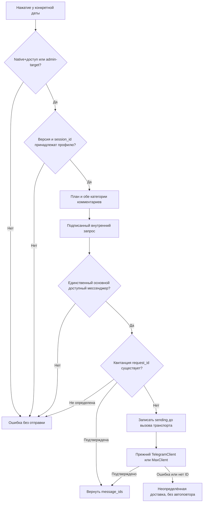

# Силовые тренировки

Приложение планирования и фиксации силовых тренировок с упражнениями и аналитикой.

## Функции

- Запуск: `getWorkout&initial=1` выбирает последний использованный активный шаблон.
  Первый ответ содержит общую историю один раз; после появления рабочего журнала
  каталоги остальных шаблонов загружаются последовательно в фоне через `catalog_only=1`.
  Они не заменяют историю, текущую версию сохранения и пользовательский ввод.
  Изменение каталога во время фонового чтения заставляет перечитать каталог после записи.
  Общая оболочка ожидает `initialLoadReady` через `EdabalansEmbed.waitUntilReady`;
  до этого приложение и подвал скрыты одним загрузчиком. GET ограничен15секундами.
- PWA: `/assets/strength.webmanifest`, запуск `/training`, standalone, существующая
  иконка руки вPNG180/192/512. Android и iPhone используют тот же серверный кабинет.
  Service worker и offline-база не добавлены; ответы API тренировок — `no-store`.
  Локально остаются только настройки интерфейса и штатная авторизация браузера.
- Нажатый глазик показывает уплотнённую историю, оранжевая полоска режима;
  отжатый — целые тренировки, зелёная полоска. Переключение приводит к правому краю.
  Верхняя строка: иконка, почта фиксированного кегля, масштаб, вопросик, статистика, ЛК.
  Полноэкранная карточка упражнения и диалоги компенсируют масштаб журнала;
  статистика не наследует CSSzoom рабочего журнала.
- Календарь получает названия из общего списка шаблонов; цвет назначен позиции
  шаблона, номер записи отображается без технического префиксаТ1/Т2.
- Голубой фон отдельной ячейки плана — больше соответствующего факта того же
  подхода в предыдущей выполненной записи упражнения; серый — меньше;
  равенство/отсутствие сравнимого факта — белый. История сравнения общая для шаблонов.
- Номер подхода — кнопка с тонким цветным кружком без заливки: зелёный означает разминку,
  красный — рабочий подход. Нажатие переключает `sets[].role = warmup | work`;
  цифра12px/800, кружок18×18px, собственная область20×30px не перекрывает поле веса.
  Боковые отступы сокращены; компактная колонка228px. Для упражнения без истории
  создаются четыре рабочих подхода; автоматического определения разминки по весу нет.
  Роль сохраняется в JSON состояния, возвращается API и участвует в undo/redo.
  Старый клиент без поля сохраняет прежнюю роль соответствующего set_number;
  остальные значения отклоняются как `INVALID_SET_ROLE`. Новая таблица/миграция не нужна.
  RPE и факт не переписываются при смене роли.
  Новая тренировка автоматически наследует роли и количество подходов из последней
  сохранённой записи каждого упражнения в общей истории, в том числе другого шаблона.
  Последняя запись определяется порядком тренировок, не датой редактирования и не
  наличием факта: разметка пустого плана тоже переносится. Числовые поля, RPE,
  выполнение и комментарии не копируются. Новые записи сохраняются обычным API;
  прежние тренировки задним числом не меняются.
  Ручное копирование плана либо факта переносит роли в буфер вместе с числами;
  вставка в план заменяет соответствующие роли поверх автоматически унаследованных.
  Уже введённые факт/RPE сохраняются; дополнительные подходы с фактом не удаляются
  и сохраняют свои роли. После вставки буфер очищается. Undo/redo возвращает обе части.
  Прогрессия допускается только для рабочих подходов. Разминка не участвует в
  готовности RPE, проверке выполнения, очереди, бюджете прибавки или оценке спада;
  её значения сохраняются без автоматической прибавки. Незаполненная разминка
  не означает недовыполнение рабочих. Автопрогрессия остаётся локальным исследованием,
  отдельно от пользовательского интерфейса. Расчёт по кнопке в админке описан ниже.
  Научные опоры и границы проектных правил — [карта доказательств](../../../../content/training/reference/progression-evidence.md).
- Самолётик в целом виде отправляет сохранённый план всей тренировки,
  в уплотнённом — только сохранённое упражнение выбранной записи. Перед запросом
  открывается собственное окно с названием и действиями «Отменить»/«Отправить».
  Необязательный `exercise_id` проверяется внутри указанной тренировки владельца;
  получатель и платформа по-прежнему определяются сервером, а не клиентом.

## Справочные диапазоны и расчёт тренера

Единственный справочник 50 базовых упражнений — поле `training` в
`backend/app/strength_exercise_guides.json`: рабочий диапазон, тип нагрузки,
единица записи, минимальная прибавка-ориентир и условия её использования.
Для статики диапазон и шаг задаются в секундах. Помощь гравитрона уменьшается
при усложнении; вес одной гантели отличается от суммарного веса штанги.
Физическая ступень конкретного тренажёра не выводится из его названия.
Карточка i сначала показывает демонстрацию, затем компактную плашку с диапазоном
и шагом прибавки веса. Единицы и ограничения программы объясняются в курсе,
а не повторяются в каждой карточке. Собственные упражнения не получают выдуманного профиля.
Редактирование состава шаблона сохраняет справочные поля каталога.

Диапазоны — стартовые настройки программы, не доказанные уникальные оптимумы
по каждому движению. Основания и ограничения — в единой карте доказательств.

В защищённом просмотре клиента из админки (`MANAGED_TARGET`, а не старый
`app.isAdmin`) под последним подходом каждой сохранённой карточки есть
«Рассчитать прогрессию». Основной интерфейс общий с пользователем; у пользователя
кнопка и действия расчёта недоступны. Чтение и сохранение сохраняют прежнюю
серверную проверку администратора и целевого пользователя.

Чистое ядро `strength-progression-model.mjs`, policy0.4.1, загружается лениво
при расчёте. Его математика перенесена из согласованного локального прототипа
без изменения очереди/формул; ИИ и внешние вычислительные API не вызываются.
По уточнению владельца кнопка одним нажатием рассчитывает и заполняет план
выбранной карточки; отдельной кнопки «Применить» нет. Факт/RPE, роли и комментарии
сохраняются; обычный undo и очередь сохранения продолжают работать. Параметры
и пояснение последнего расчёта свёрнуты под кнопкой. Если данные изменились,
пока загружался модуль расчёта, автоматическая запись блокируется — нужен пересчёт.

Источники — предыдущие записи именно этого упражнения в общей истории,
до выбранной карточки и не позднее её даты. Пустые плановые записи не являются
фактом. Последний факт выбранной карточки не используется для назначения её
же плана. При пустом плане база берётся из последней предшествующей записи;
частично заполненный план не достраивается незаметно. Два факта дают основное
подтверждение, максимум пять — контекст по правилам ядра. Разминка исключается
из прибавок и оценки рабочих результатов.
При одинаковой дате порядок фактов соответствует порядку записей журнала,
а не случайным UUID. До вызова ядра проверяется совместимость диапазона:
рабочий базовый план должен быть внутри него, последний рабочий факт может
быть ниже нижней границы, но не выше верхней. Конфликт требует явного уточнения
диапазона или базового плана; разминка в этой проверке не участвует.

Тренер может перед расчётом уточнить диапазон и фактический шаг оборудования.
В «Особых условиях» явно отмечаются облегчённая предыдущая тренировка,
изменённые условия либо повтор без прибавки. Примечания не интерпретируются
автоматически. После облегчения требуется явно заполненная обычная база.
Для пользовательского упражнения сначала задаётся профиль расчёта. Эти
параметры относятся к текущему расчёту, не создают скрытых персональных
настроек в БД. Недостаточные данные дают пояснение вместо придуманного плана.

В пользовательской справке не описываются исследовательское сравнение с ИИ
и внутренние допущения расчёта. Подготовленный туториал — отдельный редакционный
оригинал в папке материалов, 8 страниц с реальными скриншотами приложения и нумерованными пояснениями; локальный просмотр и текст
проходят приёмку перед заменой действующей справки. Он включает три разных
смысла цвета: роль подхода, выполнение плана и сравнение плана с прошлым фактом.

- масштаб возле почты выбирается из выпадающего списка50–150% с шагом5% и сохраняется локально в браузере.
  В нажатом компактном виде масштабируются все размеры; в отжатом целом виде
  горизонтальные размеры остаются прежними, растут кегль и вертикальные размеры.
  Кегль ограничен вместимостью поля (вес3/повторы2цифры), чтобы увеличение не скрывало значения.
  Уведомления доставки показываются внутри интерфейса, без браузерных alert.
  Скролл ленты — единственный источник синхронизации закреплённой строки дат;
  обратной записи scrollLeft из визуальной строки дат нет.
- ручная отправка ПЛАНА конкретной сохранённой тренировки владельцу профиля через
  его основной привязанный Telegram/MAX, без выбора канала и без fallback.
  Одинаковая моноцветная иконка Telegram стоит у номера/даты, справа от удаления
  в целом виде, и возле даты в уплотнённом виде. Пользователь отправляет себе,
  администратор — владельцу выбранного профиля. Большая наружная кнопка удалена.
  Факт не заменяет план при отправке. Заголовок с названием шаблона, упражнения
  по порядку, emoji-номера, отдельные строки подходов без таблицы, обе категории
  комментариев со звёздочкой/курсивом. Код/доставка — технический payload по явному
  нажатию, не новая автоматическая цепочка. API `/api/apps/strength/send-plan`
  проверяет существующую native/product/курсовую границу либо admin-target, версию
  и принадлежность session_id. Клиент не задаёт chat_id/канал. Внутренняя доставка
  `/internal/strength-plan` подписана APP_AUTH_SECRET с префиксом strength-plan;
  существующий preferred_destination заново выбирает единственную привязку.
  Используются прежние TelegramClient/MaxClient, maintenance и журнал tg_manual_messages.
  Повтор request_id возвращает подтверждённые квитанции; неопределённый результат
  не переотправляется автоматически. Частичный сбой содержит число подтверждённых
  частей. Успех UI — только после ответа с message_ids. Состояние тренировок не меняется.
  Передача backend→bot: STRENGTH_DELIVERY_ENDPOINT, по умолчанию
  http://telegram-bot:8001/internal/strength-plan; нового секрета/SQL migration нет.

- прежний личный API-пилот владельца сохранён для совместимости, без наружной кнопки
  в новом журнале: отправка выбранной сохранённой тренировки в личный Telegram владельца через
  существующего основного бота; чужой профиль отправляется владельцу, а не клиенту;
  получатель задаётся положительным private chat ID в `STRENGTH_TELEGRAM_OWNER_ID`
  backend; пустое значение запрещает доставку. Для включения сверить личность
  владельца `@svorontsovski` по действующей привязке и private-чату основного бота,
  затем задать ID в серверном `.env` и штатно пересоздать backend;
  основной токен берётся из существующего `TELEGRAM_TEST_BOT_TOKEN`;
  backend использует тот же настроенный relay основного бота через существующие
  `TELEGRAM_API_BASE_URL` и `TELEGRAM_GATEWAY_TOKEN`, без смены маршрута бота;
  если в тренировке есть факт, отправлять только подходы с фактом и RPE, иначе план;
  выполненный/RPE-подход без отдельных фактических полей использует сохранённый план;
  частично заполненный факт не дополнять планом без отметки выполнения или RPE;
  сохранять примечания и пометки примерных данных, номер, ID, шаблон и дату;
  длинные сообщения делить с повторением идентификатора тренировки;
  отправка требует административной авторизации и актуальной версии, ждёт сохранения
  в UI, не меняет тренировки и записывает успешную доставку в существующий аудит;
  повтор после сетевой ошибки выполняется только вручную после проверки чата.
  Голосовые ответы, расшифровки и автоматическое изменение факта в этот пилот не входят.

- вести план/факт и общую историю по exercise_id независимо от шаблона; сохранять
  идентификаторы, даты и provenance при редактировании существующих записей;
- предоставлять три шаблона новому профилю и управление количеством, названиями,
  порядком, составом/порядком упражнений; удаление шаблона оставляет историю и tombstone;
- показывать историю выбранного шаблона одной общей горизонтальной осью с общими
  номерами тренировок; последняя запись справа, количество колонок не ограничено тремя;
- переключать глазиком два вида истории: отжатый — целые тренировки выбранного
  шаблона с пустыми местами и общей закреплённой строкой дат; нажатый оранжевый — заполненные
  записи каждого упражнения из всех шаблонов, без пустых промежутков, справа,
  с номером/датой над каждой записью. Полностью пустые записи завершённых тренировок скрыты только в этом
  виде; пустые тренировки текущего шаблона и planned без факта остаются доступны,
  включая несколько созданных подряд. Их история не удаляется автоматически; план без факта, RPE, отметка выполнения или примечание сохраняют запись;
  общая прокрутка всех упражнений и плюс создания остаются в обоих видах;
- в виде целых тренировок на телефоне одна колонка занимает всю рабочую ширину:
  поля факта и RPE крупнее, план редактируется и остаётся меньше факта, вокруг
  круглой отметки больше места. Горизонтальный свайп переключает соседние тренировки;
  при перерасчёте ширины колонки сохраняется просматриваемая запись. На ПК целые тренировки
  остаются компактными колонками. Уплотнённая история упражнений компактна на всех
  экранах; это различие представления, а не разделение прав пользователя/администратора;
- выбранный шаблон — белая кнопка с мягкой тенью на серой ленте; отметки выполнения
  имеют более нежные непрозрачные зелёную/фиолетовую/жёлтую заливки. Светлые цвета
  шапок упражнений идут по далёким соседним оттенкам, пять наборов по семь цветов,
  с восьмой позиции повторяются; шкала RPE и данные от смены оформления не меняются;
- заполнять пустое историческое место упражнения только при редактировании, без
  автоматического создания результатов; выравнивать высоту карточек по максимуму подходов;
- показывать закреплённые управление и номера/даты над каждой колонкой; красный
  крестик справа от даты удаляет именно её тренировку с подтверждением номера/даты;
- создавать тренировку без даты; факт, RPE и перенос плана в факт разрешены после
  выбора даты. Поле даты readonly: текст и значок открывают нативный календарь,
  видимое значение русское, сохранение прежним ISO. Цифрового ручного ввода нет;
- в компактных колонках держать вес/повторы плана на3/2цифры, факт примерно на10%шире,
  RPEнаодинсимвол; номер подхода и круглый индикатор остаются компактными.
  Дробный вес принимается
  с точкой/запятой; пустойRPE — прочерк, курсор числового поля справа;
- переносить план/факт через одноразовый буфер только в план того же упражнения,
  без скрытого создания тренировки и без очистки факта/RPE/примечаний назначения;
- круглая отметка переносит план в факт, повтор очищает фактические вес/повторы,
  сохраняяRPE; сравнение сначала по весу, затем по повторам, неполные данные нейтральны;
- показывать примечание всегда одной строкой: заполненное мягко выделено и сокращено
  многоточием. Нажатие открывает полный текст с редактированием/сохранением в общем
  интерфейсе пользователя и управляемого профиля; само превью текст не обрезает в данных;
- в одном окне примечания редактировать две независимые категории: «Комментарий тренера»
  и «Ваш комментарий», обе доступны из общего пользовательского/административного UI.
  По уточнению владельца21.10 старые note — пользовательские, если нет прямого указания
  обратного; сохраняются в прежнем поле note без перезаписи. Новое coach_note хранится
  в существующем JSON упражнения StrengthState, SQL migration/массового переноса нет.
  Пустая плашка белая, пользовательская мягко-оранжевая, тренерская голубая, обе —
  соседние части одной плашки; полный текст в окне, без счётчика и лишнего подзаголовка.
  Редактировать обе категории может любой из двух контекстов: это не доказательство
  авторства. Старый клиент, не приславший coach_note, не стирает сохранённое поле;
- компактные элементы имеют короткие native title по действию/состоянию, без отдельной
  обязательной мобильной всплывашки. У сохранения три состояния: процесс/сохранено/ошибка;
- отменять/повторять изменения кнопками и Ctrl/Cmd+Z/Y/Shift+Z с русской раскладкой;
  сохранить очереди отправки, актуальнуюversion и остановку при конфликте другой вкладки;
- внутреннюю информацию, примечания, статистику и вложенный редактор включать в
  историю браузера: Back/Forward и явные возвраты работают внутри приложения;
  Back из корня не блокирует уход. Выбор записи и положение просмотра не сбрасываются;
- открывать статистику отдельным экраном с возвратом; карточку упражнения — иконкойi
  с полным названием, исходной демонстрацией, техникой, мышцами/схемой и атрибуцией;
  короткое название в журнале и полное в информации принадлежат общему каталогу;
- отмечать личные упражнения звёздочкой в журнале и редакторе; кнопка информации
  объясняет, что упражнение добавлено самим пользователем и подготовленного описания нет;
- использовать единый рабочий интерфейс в пользовательском/административном режиме,
  открываться через /training, совместимый /strength, курс и проверенныйTelegramMiniApp;
  права, user_id и проверка подписанногоTelegramID остаются общими;
- в админке хранить выбор пользователя снаружи журнала, в тонкой закреплённой строке
  с меню/email/возвратом к списку силовых. Сразу под ней закрепляется обычный блок
  журнала. Большие внешние поля, высокая шапка и переключатель приложения в выбранном
  силовом профиле не выводятся. Другие приложения сохраняют прежнюю оболочку;
- показывать загрузку/успех/ошибку сохранения внизу справа; инструкция«Как пользоваться»
  намеренно оставлена прежней до отдельного задания на текст и скриншоты.

## Граница

Не включает будущий отдельный продукт или redesign без новой задачи.

## Рабочий маршрут

Эта карточка — вход в приложение тренировок, а не в тексты тренировочного курса.
Общий вход/API: [платформа приложений](../../../APPLICATION_PLATFORM.md).
Plan/fact, история упражнений и импорт принадлежат `products.strength`; тексты
для ученика проходят через `platform.content` и Писаря. Не переносить сюда
методику DQS или калькулятора и не создавать отдельную копию общих прав/сессии.
При импорте читать фактический legacy-источник ниже и безопасный маршрут
`docs/OPERATIONS.md` от корня проекта.

## Источники истины

Состав базового каталога и принятые карточки находятся в
`backend/app/strength_exercise_guides.json`. Идентификаторы прежних 31 упражнений
сохранены; 19 добавленных доступны для включения в шаблон без миграции истории.
Карточки передаются вместе с каталогом, не записываются в результаты человека.
Локальные GIF и схемы обслуживаются allowlist-маршрутом
`/assets/strength-exercises/<имя>`; имя содержит хеш неизменённого медиа.
09.10.2026 владелец прямо поручил перенести найденные исходные GIF и схемы на
сервер с сохранением водяных знаков и короткой атрибуцией. Это поручение не
является подтверждением лицензии правообладателей. Пример «Жим штанги лёжа»,
распространение короткой атрибуции на все 50 карточек и выпуск в production
подтверждены владельцем 09.10.2026. Источники: BurnFit для 49 GIF, Gymvisual
для жима платформы гравитрона одной ногой, FitnessProgramer для схем мышц.
Медиа входят в штатный пакет backend; серверная staging-копия сверена по SHA-256.

09.10.2026 по уточнённому поручению владельца создан отдельный справочный материал
«Каталог упражнений по мышцам»: 50 упражнений, 12 групп целевых мышц.
[Карточка состояния и рабочий файл](../training/MATERIALS_AND_SOURCES.md) принадлежат
`products.training`; названия, мышцы и карточки упражнений — `products.strength`.
Материал сохранён в постоянной папке материалов, в runtime курса не опубликован.
Оболочка курса и отдельный механизм открытия карточек из материала не реализовывались.

`docs/APPLICATION_PLATFORM.md`, backend runtime и `legacy/google/strength/` при переносе.
Для Валентины фактическим источником является актуальная вертикальная вкладка её
персональной Google-таблицы; нормализованная таблица служит старым снимком и не
определяет последние тренировки.
Импорт различает смену упражнения внутри сохранённой строки таблицы: точное известное
название начинает новую историю упражнения с этой тренировки, обычные комментарии остаются
заметками.

Для сквозной перенумерации сначала сортируется общая история человека по сохранённым
датам, затем интерфейс фильтрует её по выбранному шаблону с пропусками чужих номеров.
При одинаковой дате записи сохраняются отдельно, в порядке шаблонов 1/2/3, затем старого
номера и `session_id`. Планы без даты остаются после датированной истории в порядке
старого номера; даты им не назначаются автоматически. `legacy_group`, время создания
и обновления не подменяют дату тренировки. Старый номер сохраняется как
`legacy_session_number`, а подходы, упражнения и их идентификаторы не меняются.
Новый Google-импорт отказывается заменять уже созданное состояние профиля.
Уточнённый каталог разделяет мост в тренажёре и со штангой, гиперэкстензию,
разведение рук в тренажёре и жим платформы гравитрона одной ногой.
Сгибание ног в текущем каталоге выполняется лёжа, подъёмы на носки — стоя.
Однократное объединение legacy-идентификаторов с базовыми упражнениями сохраняет
подходы, заметки, даты, номера и исходные названия/идентификаторы как метки происхождения.
Смешанная строка тяги верхнего блока/подтягиваний разделяется по первому явному
примечанию «Подтягивания в гравитроне», а не по догадке о весах.
Текущий шаблон использует последнее упражнение этой строки; прежняя тяга остаётся
в общей истории и видна при включении тяги верхнего блока в шаблон.
Перенос каталога применяется только к подтверждённому профилю и версии состояния,
после dry-run, резервной копии и проверки восстановления; совпавшие записи
одного упражнения в одной тренировке блокируют перенос вместо потери результатов.
Существующие профили переводятся отдельно по подтверждённому запуску. До применения
переноса их старая история может содержать повторяющиеся номера разных шаблонов. Исполняемый маршрут —
`backend/scripts/migrate_strength_global_history.py`: без `--apply` он делает dry-run,
`--details --user-id` показывает соответствие старых и новых номеров. `--apply` требует
конкретный `--user-id` и `--expected-version`; его применяют только после backup,
проверки восстановления и явного подтверждения владельца. Изменённая после dry-run
версия блокирует применение.

Технические файлы, routes, таблицы, migrations и программные символы не
перечисляются вручную в карточке: они подставляются из generated inventory.

09.10.2026 по уточнению владельца `machine-lateral-raise` называется
«Разведение рук в тренажёре на средние дельты», как в принятой карточке.
В исходной таблице Анны это «Плечи тренажер». Идентификатор, принадлежность
шаблонам и результаты остаются прежними.

## Компактный журнал — принят к выпуску21.10.2026

По запросу владельца подготовлен и21.10разрешён к выпуску: строка значка, помощи,
статистики и ЛК; компактный профиль и горизонтальная лента именованных шаблонов.
Последнее уточнение владельца21.10 исправляет неверную трактовку прежнего ответа
о масштабе: глазик переключает целые тренировки и уплотнённую историю
упражнений. Последнее уточнение21.10 меняет только индикацию: отжат — целые
тренировки, нажат оранжевый — уплотнённая история. Во втором виде над каждой карточкой собственные номер и дата,
полностью пустые записи исключены, последние выровнены справа. Записи включают
план без факта; история общая по exercise_id из всех шаблонов. Прокрутка единая.
Плюс не исчезает и не перемещается; при добавлении открывается новая пустая целая
тренировка выбранного шаблона для заполнения. Исправление представления не меняет
данные/идентификаторы и не запускает запись при переключении.
Следующее уточнение21.10 сохраняет оба вида и добавляет телефонное оформление
целой тренировки: одна колонка во всю ширину, увеличенные факт/RPE и промежутки
около круглой отметки при редактируемом более компактном плане. На ПК остаются
соседние компактные колонки; уплотнённая история компактна и на телефоне. Отдельного
административного renderer или ограничения доступа к переключателю нет.
Административная оболочка загружает тот же renderer, выбор человека остаётся снаружи.
Закреплённая панель имеет два уровня: отмена/повтор, лента выбора шаблона, единая
кнопка управления шаблонами, глазик и создание; ниже отдельный номер, дата и удаление справа от даты
над каждой колонкой целой тренировки, синхронно с общей горизонтальной прокруткой.
В уплотнённом виде второй закреплённой строки дат нет. Удаление целой тренировки
доступно в целых тренировках. Номер выделяет выбранную тренировку и переводит к ней просмотр; удаление
привязано к собственному крестику справа от даты. Свайп постоянный;
на ПК одна нижняя полоса общей истории. После исправления задержки свайпа
лента карточек — единственный источник scrollLeft для закреплённой строки дат;
обратного обработчика прокрутки строки дат нет.
Новая тренировка без даты; факт, RPE и заполнение по плану требуют выбранной даты.
Копирование плана/факта заполняет внутренний буфер без записи и создания сессии;
вставка доступна только в план того же упражнения и подсвечена. Факт/RPE/примечание
сохраняются; лишние подходы с фактом не удаляются при вставке более короткого плана.
Индикатор сравнивает сначала вес, затем повторы: меньше — жёлтый, равно — зелёный,
больше — фиолетовый; неполный подход нейтрален. Круглый индикатор переносит план
в факт; повторное нажатие на заполненный индикатор очищает вес/повторы факта,
сохраняя RPE. Успешная вставка плана очищает внутренний буфер.
Шаблоны управляются через существующий версионный JSON состояния: название, порядок,
добавление и удаление с подтверждением. Удалённые идентификаторы не используются снова;
вся история сохраняется. По умолчанию новых профилей три шаблона.
Карточки используют одинарные рамки и белые поля, плюс/минус подход в заголовке,
однострочное превью любого примечания с полным текстом в окне, общую высоту по максимуму подходов упражнения.
Подсказки «раз» и «кг» имеют одинаковый уменьшенный кегль: «раз» помещается
в ширину двух цифр, размер вводимых чисел сохранён.
Статус загрузки/сохранения/ошибки находится внизу справа. Статистика открывается
отдельным представлением с единственной верхней строкой возврата к тренировкам.
Числа исходной истории и права не меняются; локальные изменения хранятся отдельно.
Предыдущие режимы редактирования/начала и отдельная административная таблица
заменены единым журналом. История, права и идентификаторы сохраняются.

Уточнение локального варианта21.10: выбор RPE начинается с5: голубой5, мятный6,
жёлтый7, персиковый8, мягкий фиолетовый9,10 — красная ячейка с цифрой10;
по последнему уточнению владельца крестик заменён на число и в выборе, и в журнале. Все символы
одного тёмного цвета; прежние значения истории не переписываются.
Индикаторы выполнения пастельные: салатовый, мягкий фиолетовый и солнечный
жёлтый, с контрастными тёмными галочками. Номер и дата тренировки чёрные,
цветная рамка/подсветка выбора сохранена; крайние кнопки имеют отступ8px.
Редактор состава/порядка упражнений открывается внутри управления шаблонами
и возвращает туда после закрытия. Глазик находится в закреплённой панели рядом
с добавлением, в виде упражнений остаётся в той же панели; нажатое состояние выделено.
Удаление красное, создание зелёное. Номер перед датой и сама дата имеют отдельные
постоянно видимые рамки. Номер упражнения15px без рамки/подложки,
центрируется с названием и кнопками. Размер названия сохранён. Цвет полосы и
контура зависит от позиции упражнения в текущем шаблоне: пять наборов по семь
цветов; восьмая позиция повторяет первую, девятая — вторую. Набор выбирается по
порядку активных шаблонов, не по идентификатору упражнения; история не меняется.
Изменение количества подходов сохраняет вертикальную и горизонтальную позицию
просмотра. Ранняя правка переноса примечания по высоте была отменена. Новая правка21.10
заменяет любое превью одной строкой с полным текстом в редактируемом окне.

Названия всех50 базовых упражнений подтверждены владельцем21.10: короткое
в карточке журнала, полное в заголовке информации. Источник — short_name/full_name
в общем каталоге, без переименования идентификаторов или записей истории.

Уточнения выпуска: выбранный шаблон явно подсвечен и отмечен aria-pressed;
из редактора состава есть верхняя «Назад к шаблонам», из управления шаблонами —
«К тренировкам». Крестик у каждой даты удаляет именно её сессию, подтверждение
показывает номер/дату. Видимое поле даты всегда использует «дд.мм.гггг», вне зависимости от языка браузера;
текст и значок открывают нативный календарь, цифровой ввод запрещён. Выбор
сохраняется прежним ISO-значением.
Прежний административный API личного экспорта сохранён, но его наружный контрол
заменён общей кнопкой плана у каждой даты. Блокировка до окончания сохранения действует
для обеих пользовательских поверхностей; сам план отправляется владельцу профиля.

Приёмка интерфейса: backend/tests/browser/strength-history-views.e2e.mjs;
прежний entry strength-editor.e2e.mjs направляет в эту единую проверку.
Suite сам читает HTML/CSS/модель из checkout и перехватывает API синтетическими
данными; личный снимок и локальный preview-сервер ему не нужны.
Запуск: QA_OUT=<каталог доказательств> node backend/tests/browser/strength-editor.e2e.mjs
(Playwright из обычного node_modules либо PLAYWRIGHT_MODULE_URL/CODEX_NODE_MODULES).

Состав нового шаблона и порядок сохраняются адресно и восстанавливаются после
перезагрузки, без перезаписи истории. Удаление шаблона снимает ожидающие записи
его состава после завершения уже отправленного запроса. При расчёте высоты пустые
четырёхподходные карточки учитываются только там, где они действительно показаны;
уплотнённая история использует максимум фактических подходов.

Навигация внутренних экранов использует историю браузера с state.edStrengthScreen,
не копию бизнес-данных. Административный popstate не перезагружает профиль при этом
маркере. Приёмка проверяет настоящиеadmin.html/admin.js/admin-shell.js/CSS с
синтетическимAPI, а не только контейнер с подписью администратора.

### Правки заполнения и компактной истории

При нажатии мышью на числовое поле значение выделяется целиком для замены вводом;
на сенсорном устройстве сохраняется установка курсора справа. Блокировка факта
до выбора даты остаётся общей для обоих способов ввода.
Последняя тренировка выбранного шаблона отображается для всех его упражнений
и в компактном виде, даже пока пустая или заполнена частично. Более старые пустые
записи по-прежнему скрываются; заполненная история из других шаблонов сохраняется.
Добавление не переключает выбранный вид и прокручивает новую запись в видимую область.
Строки отдельных упражнений выравниваются по правому краю общей оси.
Крестик рядом с каждой датой доступен в обоих видах: удаляет всю соответствующую
тренировку со всеми упражнениями через прежнее подтверждение с номером/датой.
Отмена восстанавливает тренировку; сквозная нумерация не пересчитывается.

### Ручная доставка плана

Единственный машинный контракт выбора канала — существующий preferred_destination;
producer strength_workout_plan зарегистрирован как technical_payload/proactive=false.
Не создаётся scheduler/sequence и не используется старый endpoint с фиксированным
владельцем. Подтверждённый владельцем формат технического сообщения формируется
plan_messages, все вставляемые значения экранированы; длинные части сохраняют HTML
и лимит обеих платформ. Это выдача пользовательских данных, не авторский пост.

Проверки: backend/tests/test_strength_delivery.py,
telegram-bot/service/tests/test_strength_delivery.py и общий browser suite.
Локальный preview не подключает реальный мессенджер: он явно сообщает, что
отправка отключена, вместо имитации успешной доставки.

## Выбор клиента — 22.10.2026

Владелец под своей действующей нативной сессией может выбирать клиента из приложения; прежний вход из админки сохранён. Полномочия, переключение и изоляция данных принадлежат общему договору `docs/APPLICATION_PLATFORM.md`, раздел «Выбор клиента из приложения».
