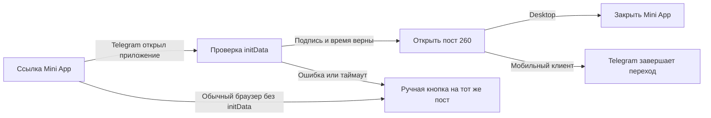

# Модуль 1. Первичный вход и атрибуция лида

Статус: `current`
Состояние внедрения: Telegram-start, legacy/короткие ссылки, UTM-справочник и
channel invite и передача источника в прямой checkout реализованы;
Браузерная связь и путь подключены к управляемым поверхностям сайта; правила — § 9.2.2.
Владелец содержания: Сергей Воронцов  
Проверено: 17.09.2026
Источники: `../../../plans/TELEGRAM_START_LINKS_SPEC.md`, `../../../plans/TELEGRAM_CHANNEL_ATTRIBUTION_SPEC.md`, `../../../TAG_RULES.md`

Этот документ — каноническая база знаний подмодуля. Telegram-start, aliases,
legacy mapping, управляемые UTM, first-touch tags и путь channel invite → поздний
Start реализованы. Прямая оплата получает источник персональной ссылки или
текущие метки страницы; Браузерный путь дополняет снимок источника; checkout работает и без него.

## Канальные ссылки и наблюдения —19.10.2026

Конструктор `/admin/channel-links` использует общую админку. Архивный экран
сохранён в `/bot#links`, прежние записи и API не удалены. За одним стабильным
шестизначным кодом хранятся название, площадка/размещение, целевой пост и режим
запроса разрешения писать. Профильные ig/yt/th/pk/dz/vk/tt, рекламный ya и общий site сохраняют
короткие коды. Изменение настройки не меняет адрес ссылки.

Адрес: `https://t.me/Fitness_Talks_bot/channel?startapp=<code>`. По умолчанию
Mini App запрашивает разрешение; переключатель пропускает запрос. После любого
результата открывается настроенный пост без обязательного Start. Сохранены
Android-маршрут и карточка ручного перехода. Само разрешение не отправляет
приветствие и не запускает отложенные сообщения.

Каталог — существующие tg_tracking_links/aliases, конфигурация — версионный
managed document типа channel-entry-link с ключом id ссылки и optimistic lock.
Новой физической таблицы или migration нет. Разрешены только HTTPS-ссылки на
посты Fitness_Talks. Подпись и свежесть initData проверяет сервер; сырые initData
не сохраняются. Снимок настроек первого открытия сохраняется на весь визит.

Рекламная посадочная использует существующий start-link API и U-journey: Telegram
deep link и QR открывают Mini App напрямую. Сохраняются yclid, UTM, browser_context,
entry/device и прежние разрешённые tag_id. Первое проверенное открытие расходует
U-сессию; callback и повтор того же подписанного открытия используют снимок.
Посадочная передаёт Telegram alias ya, её валидация принимает /channel?startapp=U…;
MAX сохраняет прежний BMB6Y и bot-start маршрут. При выпуске конструктор открывают
один раз для создания профильных кодов до проверки рекламных ссылок.
Старые bot_start ссылки остаются прежними. MAX channel-entry здесь не включён:
незарегистрированный MAX-вход не заменяется вымышленной Mini App ссылкой.

### События и отчёт

В tg_tracking_events сохраняются channel_entry_open, channel_permission_requested,
channel_permission_result/unavailable, channel_open_requested. Повторы
дедуплицируются. Callback true/false — клиентское наблюдение, не доказательство
нового разрешения либо явного отказа; already_allowed берётся из подписанного
Telegram user. Webhook отдельно пишет channel_write_allowed и факт отсутствия
автоматического сообщения. channel_membership записывается для настроенного
собственного канала даже без invite и обновляет свежую подписку messenger account.
Join request не равен вступлению.

Источник webhook — последний наблюдаемый Mini App вход того же Telegram ID,
с явным basis last_observed_miniapp. Поздний Start получает ссылку и рекламный
контекст через существующий first-touch обработчик, не перезаписывая прежний
first-touch. Покупки, права, прогресс и подписка не кодируются новыми тегами.

Отчёт `/admin/api/channel-links/report`: даты Europe/Moscow, площадки и ссылки,
включая входы без Start/CRM user. Разделены клиентский результат, прежнее
разрешение, подтверждение Telegram, пропуск запроса и неизвестность. Хронология
после входа ограничена следующим входом того же человека либо концом периода;
это наблюдения, а не причинная атрибуция продаж. Чтение статьи берётся из
intensive_onepage course_events, открытие главной — из связанного browser_page.
Персональное чтение главной ещё не подключено: анонимная public_homepage_events
не выдаётся за персональную статистику. Лимит30000событий показан явно,
детали отображают до500входов. Неизвестность не равна нулю или отказу.

Переразметка статьи, связь reach главной с источником и рекламные конверсии
передаются VSL/Я.Директ после выпуска нашего входа.

## История пробы Mini App —17.10.2026

Ниже описан первоначальный тест до включения конструктора и записи событий.

Поручение Сергея от 17.10.2026: получить тестовую ссылку, которая открывает
Mini App и сразу переводит на действующий закреп канала, без Start и рассылки.
Состояние: приложение `channel` зарегистрировано владельцем в BotFather.
Владелец подтвердил переход на компьютере и после исправления мобильного
маршрута — на телефоне, включая сравнительный запрос права писать.

- Страница для BotFather по уточнению Сергея: `https://похудение-это-есть.рф/c`.
  Прежний `/apps/channel-bridge` остаётся совместимым адресом той же страницы.
- Именованное приложение создаётся через `/newapp` в BotFather для существующего
  `@Fitness_Talks_bot`, предлагаемый short name — `channel`.
- После регистрации тестовый вход:
  `https://t.me/Fitness_Talks_bot/channel?startapp=preview&mode=compact`.
  Этот адрес не считается зарегистрированным самим фактом наличия документа.
- Проверенное через `getChat` назначение на 17.10.2026:
  `https://t.me/Fitness_Talks/260`. Проба использует этот фиксированный снимок;
  новый закреп потребует отдельного изменения до рекламного запуска.
- SDK предоставляет `initData`; сервер проверяет подпись и свежесть существующим
  `messenger_init_user_id`. После ответа Android автоматически передаёт `t.me`
  назначение через обычную URL-навигацию WebView; SDK-команда на этом клиенте
  может игнорироваться без недавнего нажатия. Desktop/iOS используют SDK.
  `close` вызывается только на подтверждённых desktop-платформах; мобильное
  приложение завершает переход самостоятельно, чтобы не терять навигацию.
- Переход остаётся автоматическим на всех платформах. На промежуточном экране —
  карточка по образцу блока блога: действующая аватарка из
  `/blog/assets/sergey-author-channel.webp` слева, «Сергей Воронцов» и
  «Тренер по питанию» справа; ниже описание «Пишу о питании и похудении так,
  чтобы вы менялись.», согласованный призыв прочитать «Как сделать похудение
  проще» и подписаться, запасная кнопка «Открыть канал» на тот же пост.
  Ссылки на сайт и контакты в описание не переносятся. Повторное нажатие
  кнопки не блокируется после автоперехода. Мобильный переход владелец
  подтвердил 17.10.2026; изменение карточки не меняет этот маршрут.
- При отсутствии SDK/Telegram остаётся обычная ссылка на закреп. При ошибке
  проверки или таймауте человек может открыть тот же пост кнопкой; это не считается
  подтверждённой идентификацией. Произвольные назначения из query не принимаются.
- Обычная проба не создаёт CRM-контактов/сессий, ничего не сохраняет, не отправляет сообщения,
  не запрашивает право писать пользователю и не экспортирует рекламные конверсии.
  `startapp=preview` не является `/start` или согласием на рассылку.
- Отдельный сравнительный вход по поручению Сергея от 17.10.2026:
  `https://t.me/Fitness_Talks_bot/channel?startapp=writepreview&mode=compact`.
  После проверки `initData` вызывает штатный `requestWriteAccess`, затем
  автоматически открывает тот же закреп при согласии или отказе. Дополнительная
  кнопка внутри приложения и `/start` не нужны. При уже имеющемся праве Telegram
  может не показать запрос; старый SDK без метода просто открывает канал.
  Служебный update `write_access_allowed` сохраняет контакт через существующий
  CRM-вход, но не запускает приветствие, рассылку и не меняет stopped/blocked.
  Отложенные сообщения в эту пробу не входят. Проверка настоящего системного
  окна и видимости чата остаётся за владельцем на устройстве.
- Системное подтверждение первого открытия зависит от Telegram и не обходится.
  Реальный порядок перехода/закрытия проверяет владелец на своём устройстве.



Проверки: публичный вход без авторизации; поддельные и просроченные данные;
отсутствие cookie/DB/отправок; запрет произвольного URL; автоматический порядок
verify → автоматический переход; desktop-close и отсутствие mobile-close;
ручной переход при отказах; первый и повторный вход в
Telegram на телефоне. Код перехода не равен доказанному просмотру поста.

Мобильное поведение исследовано по официальному Android-клиенту:
`org/telegram/ui/web/BotWebViewContainer.java`, обработчики
`web_app_open_tg_link`, `onOpenUri`, `shouldOverrideUrlLoading` в репозитории
`DrKLO/Telegram`. Исследование кода и браузерные моки не заменяют тест владельца.

### Короткие ссылки по источникам

По поручению Сергея от 17.10.2026 short name `channel` сохраняется. Публичный
формат — `https://t.me/Fitness_Talks_bot/channel?startapp=<код>`, ровно один
query-параметр, без `mode=compact` и промежуточного сайта/редиректа.

| Код | Источник | Готовая ссылка |
|---|---|---|
| `ig` | Instagram | `https://t.me/Fitness_Talks_bot/channel?startapp=ig` |
| `yt` | YouTube | `https://t.me/Fitness_Talks_bot/channel?startapp=yt` |
| `th` | Threads | `https://t.me/Fitness_Talks_bot/channel?startapp=th` |
| `pk` | Pikabu | `https://t.me/Fitness_Talks_bot/channel?startapp=pk` |
| `dz` | Дзен | `https://t.me/Fitness_Talks_bot/channel?startapp=dz` |
| `vk` | ВКонтакте | `https://t.me/Fitness_Talks_bot/channel?startapp=vk` |
| `tt` | TikTok | `https://t.me/Fitness_Talks_bot/channel?startapp=tt` |

Единственный машинный владелец соответствий — `ENTRY_SOURCES` в
`backend/app/channel_bridge_routes.py`. Сервер после проверки подписи извлекает
`start_param` и возвращает источник и режим запроса права писать. Все перечисленные
коды включают штатный запрос и ведут на один проверенный закреп при любом ответе.
JS исполняет режим из ответа сервера, а не из `initDataUnsafe`.

Старые `preview` и `writepreview` работают как прежде: первый без запроса,
второй с запросом. Неизвестный/пустой код открывает закреп без запроса и без
определённого источника. Это не новая система атрибуции: распознанный источник
пока не сохраняется, статистика и рекламные конверсии не включены.
Для Директа остаётся договор существующей посадки с Telegram/MAX-кнопками:
персональный рекламный journey нельзя заменять общим кодом площадки.

## 0.1. Обязательная политика длины и прямых переходов

Новые публичные tracking/progress-коды делаются максимально короткими. Для
обычных правил уже используется пятисимвольный код, для персонального входа в
интенсив — девятисимвольный код. В ссылку не зашиваются email, Telegram ID,
название кампании и другие читаемые персональные или служебные данные. Старые
длинные ссылки продолжают разрешаться и не ломаются.

Ссылки между Telegram-ботом и Telegram-каналом, а также аналогичные ссылки MAX,
по умолчанию идут напрямую и не проходят через `go.` или другой наш сайт. Это
касается обоих направлений `бот → канал` и `канал → бот`. Промежуточный redirect
для такого перехода разрешается только в конкретном месте после отдельной явной
просьбы владельца. Само наличие технического route не разрешает автоматически
использовать его в новых сообщениях.

Персональная идентификация по умолчанию применяется к пути `бот → наш сайт` и к
действиям уже на сайте. Одноразовые ссылки авторизации и выдачи доступа являются
секретами безопасности и не сокращаются до длины обычного tracking-кода.

## 0. Граница модуля

Модуль начинается в двух точках:

1. владелец создаёт/импортирует правило ссылки в админке;
2. внешний человек открывает отслеживаемую ссылку, вступает в канал, запускает
   бота либо переходит на сайт.

Модуль обязан:

- распознать код или UTM по управляемому справочнику;
- найти либо создать контакт и связать Telegram account с общим `user_id`;
- записать полное событие источника без потери предыдущей истории;
- идемпотентно назначить канонические теги источника, размещения и кампании;
- определить `первое посещение бота` или `знакомый пользователь`;
- для первого посещения зафиксировать дату первого запуска;
- вернуть следующему модулю структурированный результат идентификации и выбранный
  корневой/исключительный маршрут;
- вести каталог, подсказки, аудит и статистику всех перечисленных операций.

Модуль заканчивается после получения результата вида:

```text
user_id
telegram_account/contact
is_first_bot_visit
recognized_link_rule / unknown payload
attribution_event
assigned_tag_ids
resolved_entry_route
```

В этот модуль **не входят** проверка покупки, навигационный закреп, кружок,
приветственный текст, проверка подписки для открытия интенсива, материалы интенсива,
задержки и последующая цепочка. Они получают результат модуля 1 и реализуются
следующими самостоятельными модулями.

Исключение: события вступления в канал и статус подписки могут собираться здесь как
факты атрибуции. Решение «что отправить человеку из-за подписки» относится уже к
welcome/sequence-модулю.

### Ответственность компонентов

| Компонент | Ответственность внутри модуля |
|---|---|
| Telegram adapter | принять `/start`, Telegram user/chat, `chat_member`/`chat_join_request`; создать/revoke invite через Bot API |
| Общий FastAPI/CRM | идентифицировать человека, хранить справочники, теги, события, покупки и объединённую аналитику |
| PostgreSQL | единственный источник истины для правил, aliases, событий, связей и тегов |
| Redirect на `go.` | разобрать код и `V`, записать допустимое web-событие/cookie, безопасно перенаправить |
| Публичный сайт/checkout | сохранить browser token, передать его в заказ и вернуть в серверном событии оплаты |
| Админка | создание, импорт, расшифровка, подсказки, каталог, фильтры, статистика и аудит |

Модуль не должен держать независимые справочники одновременно в Telegram service и
CRM. Канальные адаптеры обращаются к общим данным и правилам через утверждённый
контракт.

## 1. Задача подмодуля

Подмодуль создаёт и обслуживает:

- ссылки непосредственно на Telegram-бота;
- отслеживаемые пригласительные ссылки в Telegram-канал;
- брендированные короткие формы этих ссылок;
- legacy-ссылки LeadTeh, которые уже опубликованы и не могут быть заменены;
- атрибуцию источника, размещения/поста и кампании;
- историю касаний и аналитику пути до запуска бота, сайта и покупки;
- явные исключения, ведущие на разрешённый шаг сценария.

Любая неизвестная или обычная bot-start ссылка безопасно ведёт в общий `/start`.
Источник назначается только по распознанному правилу; неизвестный код не создаёт
выдуманные данные.

## 2. Главный принцип атрибуции

Используются два слоя, которые нельзя заменять друг другом.

### 2.1. История переходов и первое касание лида

Каждый переход по управляемой ссылке сохраняется отдельным событием для
статистики. В первой версии атрибуция лида и её теги назначаются только по первому
распознанному контакту. Повторный `/start` не меняет источник лида и не добавляет
новые attribution-теги; multi-touch обработка повторных запусков отложена.

Первое распознанное касание сохраняется с одной связкой:

```text
время → человек → ссылка → источник → размещение/пост → кампания → канал события
```

Будущая multi-touch версия сможет хранить, например:

```text
1. Пикабу → Пост - Висцеральный жир → Органика 2026
2. YouTube → Ролик - Ошибки похудения → Ретаргетинг 2026
```

В первой версии связь первого поста с площадкой не теряется. Последующие клики
остаются в статистике ссылок и сайта, но не переопределяют источник лида.

### 2.2. Теги первого распознанного контакта

Для фильтрации и рассылок человеку идемпотентно добавляются выбранные владельцем
видимые теги первого контакта:

- источник: точный существующий тег CRM, например `Пикабу`;
- размещение: `Пост - Висцеральный жир`;
- кампания: `Кампания - Органика 2026`.

Старые теги не снимаются. Повторный `/start` в первой версии не назначает новый
набор attribution-тегов. Накопительная multi-touch сегментация — будущая доработка.

Канонический формат контента: `Пост - Название`, именно через тире. Формат с
двоеточием не использовать.

## 3. Справочники и выбор тегов

Источник, размещение и кампания — отдельные справочники. У записи есть стабильный
технический ID, категория, отображаемое русское название, нормализованное имя,
aliases и связанный `tag_id`.

Когда владелец вручную разбирает новое значение:

1. система нормализует повторные пробелы и регистр для поиска дубля;
2. предлагает существующую запись, если она уже есть;
3. в первую очередь выбирает существующий тег из общего каталога CRM;
4. только по явной кнопке владельца может создать новый тег;
5. правило ссылки сохраняет ID, а не копию текста;
6. переименование отображения не ломает опубликованные ссылки.

Русские буквы и пробелы допустимы в названиях и тегах. В URL используются ASCII-
коды. Автоматические теги размещений группируются/фильтруются в UI, чтобы сотни
постов не мешали обычной работе с бизнес-тегами.

## 4. Короткие коды и публичные формы

Рекомендуемый код состоит из пяти символов:

```text
B7K4P — ссылка на бот
C7K4P — invite-ссылка канала
```

Первый символ читаем человеком: `B` = bot, `C` = channel. Следующие четыре символа
генерируются случайно из алфавита без похожих `0/O/1/I/L`. Четыре таких символа
дают 1 048 576 комбинаций для каждого типа. При исчерпании пространства формат
можно расширить ещё одним случайным символом без изменения старых ссылок.

Не следует кодировать в оставшихся символах площадку, пост или кампанию: это
сделает публичный формат хрупким. Все параметры находятся у записи в PostgreSQL.

Для bot-записи доступны выбранные владельцем формы:

```text
https://t.me/Fitness_Talks_bot?start=B7K4P
https://go.похудение-это-есть.рф/B7K4P
```

Для channel-записи Telegram создаёт фактическую длинную invite-ссылку, а для
публикации используются брендированные формы с `C...`. Это одна сущность с
несколькими представлениями, а не несколько независимо настраиваемых ссылок.
`go.edabalans.ru` оставлен будущим расширением и в первую версию не входит.

### 4.1. Несколько кодов одного правила

Одно правило атрибуции может иметь несколько публичных кодов/aliases. Это нужно,
когда владелец хочет заменить старый код более удобным, не теряя историю и не
создавая дублирующие сущности источника.

В админке действие называется `Создать новый код для этого правила`. Новый и
старый коды:

- ведут в одно назначение;
- используют одинаковые теги и параметры;
- суммируются в общей статистике правила;
- доступны отдельными строками при раскрытии для сравнения версий;
- имеют собственные даты создания, активности и архивирования.

Старый опубликованный код не удаляется и никогда не выдаётся другому правилу.
Его можно отключить/архивировать. Система не объединяет записи автоматически лишь
из-за совпавших полей: связь aliases создаёт владелец явно, чтобы случайно не
склеить разные размещения.

## 5. Промежуточная страница и VPN

Базовый код всегда имеет пять символов `B/C + 4 случайных`. Необязательная шестая
буква `V` является только модификатором показа:

```text
https://go.похудение-это-есть.рф/B7K4P  → мгновенный redirect
https://go.похудение-это-есть.рф/B7K4PV → страница с подсказкой про VPN
```

Обе формы используют одно правило `B7K4P`, назначают одинаковые источники и теги
и ведут в одно назначение. `V` не создаёт новую сущность ссылки. При желании
аналитика может различать вариант показа, но основные результаты агрегируются у
общего правила.

В генераторе галочка `Сначала показать предупреждение про VPN` просто копирует
форму с `V`. Владелец также может безопасно дописать или убрать `V` вручную.
Сервер принимает `V` только строго шестым символом после валидного пятисимвольного
кода; поэтому случайная буква внутри кода с модификатором не путается.

Ограничение: `V` действует только на наши `go.`-адреса. Прямая ссылка `t.me`
обходит наш сервер, поэтому показать перед ней нашу страницу невозможно.
Автоматически и надёжно определить наличие VPN браузер также не может.

## 6. UTM: ручное обучение на фактических значениях

У системы нет заранее заданной смысловой расшифровки UTM и нет автоматического
создания тегов. Классический UTM — необязательный дополнительный вход.

Если у владельца уже есть UTM-ссылка, в админке предусмотрен импорт/разбор:

1. владелец вставляет полный URL либо фактическая неизвестная комбинация приходит
   извне во вкладку `Неразобранные UTM`;
2. система выделяет все найденные параметры и показывает исходные значения;
3. напротив каждого значения владелец ищет тег по общему каталогу CRM;
4. интерфейс прежде всего предлагает уже существующие теги;
5. только при отсутствии подходящего владелец явно нажимает `Создать тег`;
6. таблица показывает предпросмотр будущих назначений;
7. после подтверждения точное правило `имя параметра + значение → tag_id`
   сохраняется;
8. в следующих карточках совпавшие значения подставляются автоматически, а всё
   неизвестное снова заполняется владельцем вручную.

Пример:

```text
utm_source=pikabu      → Пикабу
utm_content=visceral_fat → Пост - Висцеральный жир
```

Fuzzy matching, нейросетевая догадка и автоматическая смысловая классификация в
первую версию не входят. Нераспознанные UTM группируются по нормализованной полной
комбинации. Карточка показывает исходный URL, параметры, число переходов,
первую/последнюю дату и уже известные частичные подстановки.

После сохранения ручного правила владелец может нажать отдельную кнопку
`Применить к прошлым неразобранным переходам`. Перед подтверждением показываются
число затрагиваемых событий и новые назначения. Исходные UTM не стираются. Без
нажатия правило применяется только к новым событиям. Это поведение принято для
первой версии и позднее может быть изменено.

## 6.1. Известные legacy-ссылки LeadTeh

Эти опубликованные payload необходимо зарегистрировать без изменения URL:

| Payload | Известное назначение | Статус классификации |
|---|---|---|
| `c5a79797-d6c6-4a36-8551-b07443e990a7` | частая главная ссылка с Пикабу; обычный корневой start | канонический тег источника `Пикабу` |
| `120385af-6025-49f9-b586-d01f4ca4d36b` | отдельный пост «не с похудения»; обычный корневой start | канонический тег `Пост - Не с похудения`; источник уточнить при импорте |
| `b1514e43-2459-456f-949b-5cc25e87bb10` | отдельный пост про скорость похудения; обычный корневой start | канонический тег `Пост - Скорость похудения`; источник уточнить при импорте |

Остальные прямые ссылки Пикабу добавляются отдельным импортом после парсинга.
Неизвестный legacy payload до классификации всё равно ведёт в обычный `/start`, но
не назначает источник.

## 7. Путь «ссылка → канал → бот»

1. Бот-администратор создаёт уникальную Telegram invite-ссылку для правила `C...`.
2. Брендированный адрес перенаправляет на неё.
3. При подтверждённом вступлении или join request Telegram передаёт user ID и
   использованную invite-ссылку.
4. Система сохраняет отложенное событие атрибуции по Telegram user ID.
5. Когда этот человек позднее запускает бота, событие связывается с его общей
   карточкой, назначаются накопительные теги.

Обычный просмотр публичного канала без вступления и переход по общей публичной
ссылке нельзя надёжно атрибутировать. Уже состоящий в канале пользователь при
повторном открытии invite-ссылки также не считается новым вступившим.

## 8. Админка

Отдельное приложение `Ссылки и источники` содержит две основные вкладки.

### Ссылки на бота

- создать/редактировать правило;
- выбрать источник, размещение, кампанию;
- выбрать обычный `/start` или разрешённое исключение на опубликованный шаг;
- включить промежуточную страницу для брендированных форм;
- получить и скопировать `t.me`, `go.похудение-это-есть.рф`, `go.edabalans.ru`;
- импортировать legacy UUID LeadTeh;
- видеть starts, пользователей, дальнейшие действия и покупки.

### Пригласительные ссылки канала

- выбрать источник, размещение, кампанию;
- создать Telegram invite силами бота-администратора;
- включить промежуточную страницу;
- скопировать нужную брендированную форму;
- видеть вступления, поздние старты бота и покупки;
- отозвать invite без удаления исторических событий.

Отдельные разделы: `Нераспознанные UTM`, `Справочники и aliases`, `Legacy LeadTeh`,
`Аналитика`. В каждой форме есть короткая поясняющая инструкция из этого
канонического раздела базы знаний, а не независимо написанная копия.

## 9. Аналитика и временные интервалы

Для ссылки, источника, размещения, кампании и человека должны быть доступны:

- переход/Telegram-start и уникальный пользователь;
- подтверждённое вступление в канал;
- последующий старт бота после вступления;
- время от вступления/подписки до старта бота;
- статус подписки на момент первого запуска бота;
- подписался ли человек после показанной ботом просьбы и через сколько времени;
- первый подтверждённый переход на `похудение-это-есть.рф` после старта бота;
- время от старта бота до первого перехода на сайт;
- подтверждённая покупка и выручка;
- время от старта бота и от вступления в канал до покупки;
- конверсии между последовательными этапами.

Стандартное будущее окно привязки покупки к клику — 30 дней, cookie — до 365 дней.
Это целевая cookie-схема, не срок действующего персонального `source_context`.
Cookie подключается общим серверным загрузчиком на управляемых страницах. Передача источника в прямой checkout уже
работает по правилам ниже и не требует cookie.

### 9.1. Переходы из сообщений бота

Действующая подстановка использует переменную `{{personal_masterclass_url}}`
для главной и персональные переменные интенсива. Для главной публичная форма —
`https://go.похудение-это-есть.рф/m/<код>`; код стабилен для получателя и
мессенджера и переиспользуется, а не создаётся заново для каждой отправки.
Обычный вход в кабинет — `https://похудение-это-есть.рф/lk`.
Старые выданные ссылки на серверном домене сохраняются. Новые дни интенсива
в Tilda ради этих ссылок не создаются.

Переход на главную передаёт короткоживущий подписанный `source_context`.
Источник принадлежит использованной ссылке, в том числе при пересылке;
это не доказательство личности кликнувшего и не выдача доступа.
Канон приоритета текущих UTM, проверки контекста и подтверждённой покупки —
[атрибуция прямой оплаты](../../../ROBOKASSA_PAYMENTS.md#персональная-ссылка-и-атрибуция-покупки).
Инструкция проверки финальной привязки к Метрике —
[операционный канон Директа](../../YANDEX_DIRECT_OPERATIONS.md#проверка-офлайн-конверсий-метрики).

Следующая схема детализации по каждой отправке пока не реализована. В ней
для каждой кнопки/ссылки на сайт в сообщении бот при фактической отправке создаёт
непрозрачный tracking URL, связанный одновременно с:

- `user_id` получателя;
- конкретной отправкой;
- опубликованной версией сообщения/шага;
- цепочкой или разовой рассылкой;
- целевой страницей сайта;
- источником, размещением и кампанией.

Пример публичной формы не содержит персональных данных:

```text
https://go.похудение-это-есть.рф/L8K2M
```

При клике redirect записывает событие и открывает фактическую страницу. Cookies
для точного связывания клика из личного сообщения бота не нужны: получатель уже
определён уникальным серверным token. При замене текста создаётся новая
опубликованная версия сообщения, поэтому статистика старой и новой редакции не
смешивается.

Это позволяет увидеть:

- какие первые призывы пользователь пропустил;
- какой пост дал его первый переход;
- все повторные переходы и их даты;
- сколько сообщений и времени прошло до первого клика;
- какой пост был первым триггером, а какие — последующими касаниями;
- дошёл ли пользователь затем до покупки.

Telegram не сообщает факт чтения сообщения. Система знает, что сообщение успешно
отправлено, и знает о клике; «прочитал, но не нажал» доказать нельзя.

### 9.2. Переходы из постов Telegram-канала

Статус: `planned`, отдельная интеграция сайта после первой версии модуля.

В канале один пост содержит одинаковый URL для всех читателей, поэтому код ссылки
надёжно определяет сам пост/размещение и даёт агрегированную статистику. Он не
содержит Telegram user ID конкретного читателя.

Для ссылки прямо в бот redirect на нашем `go.`-домене сохраняет UTM и `yclid`
рекламного перехода в одноразовой tracking session до Telegram Start. Параметр
`to=max` использует ту же session и открывает MAX вместо Telegram; поэтому источник
не теряется и оба мессенджера попадают в общий поток `tg_tracking_events`.
Рекламная посадка также может вызвать `POST /bot/public/start-link`: сервер создаёт
ту же одноразовую session и возвращает сразу прямой deep link выбранного бота, без
redirect. При недоступности API посадка использует постоянный прямой `B...`
fallback; старт не теряется, но UTM и `yclid` такого клика восстановить нельзя.
Для каждого мессенджера заранее создаются разные session для кнопки и QR. Создание
session фиксируется как `link_prepared` и не считается действием посетителя.
Кнопка перед прямым открытием мессенджера неблокирующе отправляет payload в
`POST /bot/public/start-link/click`, создающий `landing_button_click`. QR содержит
брендированный адрес `/q/<U...>`: при сканировании он создаёт `landing_qr_scan` и
сразу переводит в Telegram или MAX. Оба события и последующий фактический старт
несут один `journey_id`, поэтому видны точные потери по кнопке/QR и мессенджеру.
Первый старт с `yclid` передаётся в цель Метрики `bot_start` как offline conversion.
Подтверждённая Tilda/Robokassa-оплата создаёт идемпотентное событие
`purchase_paid` с суммой и валютой; при наличии сохранённого `yclid` оно также
передаётся в одноимённую цель Метрики. Фоновая синхронизация этих конверсий
запускается независимо от Telegram scheduler: отключение рассылок не должно
останавливать передачу маркетинговых событий. Ссылка-
приглашение в канал сохраняет только агрегированный `web_click`: Telegram не переносит
её query-параметры к будущему запуску бота. Redirect также может создать first-party pseudonymous cookie и
собирать историю одного браузера. Это позволяет различать повторные посещения, но
не гарантирует личность: cookie может исчезнуть, Telegram и обычный браузер могут
иметь разные хранилища, а человек может открыть ссылку с другого устройства.

Чтобы связать такого посетителя с CRM-пользователем, нужен подтверждённый мост:

1. посетитель после перехода запускает бота по deep link, содержащему безопасный
   одноразовый идентификатор браузерной сессии; либо
2. авторизуется на сайте; либо
3. ранее этот браузер уже был надёжно связан с пользователем.

После подтверждения прежние псевдонимные события этого браузера можно присоединить
к таймлайну пользователя. Без такого моста статистика канального поста остаётся
агрегированной/псевдонимной и не должна приписываться конкретному человеку по
догадке. Решение владельца от 08.10.2026 о порядке включения и сроке записано в § 9.2.2.

### 9.2.1. Связывание после покупки

Статус: частично реализовано. Прямая первоначальная покупка получает снимок
текущих меток или проверенного персонального перехода по канону Robokassa выше.
Без них источник по email не восстанавливается. Исторический webhook Tilda
сохраняет прежнюю привязку к достоверному старту; Браузерная связь и история дополняют эти источники по § 9.2.2.

Для пути `пост канала → сайт → покупка` используется следующая целевая схема:

1. брендированная ссылка поста создаёт/читает first-party cookie с непрозрачным
   `browser_id`;
2. событие клика хранит `browser_id`, код поста, целевую страницу и время;
3. `browser_id` сохраняется при движении по сайту и передаётся в заказ как
   техническое metadata-поле, не видимое покупателю;
4. после подтверждённой оплаты webhook связывает покупку, `user_id` и `browser_id`;
5. все более ранние клики этого браузера добавляются в таймлайн покупателя;
6. в аналитике поста показываются связанные покупки и выручка.

Опираться только на возврат из платёжной системы и наличие cookie недостаточно:
покупатель может не вернуться на сайт. Надёжнее передавать `browser_id` вместе с
заказом до перехода к оплате и возвращать его в серверном webhook/метаданных заказа.
Если платёжная форма или Tilda не позволяют это поле передать, потребуется отдельная
интеграция заказа либо связывание после авторизации/email; это проверяется перед
реализацией по фактическому checkout.

Если человек купил с другого устройства, очистил cookie либо оформил заказ без
передачи `browser_id`, система не должна угадывать связь. Такая покупка остаётся без
точной привязки к канальному посту, пока не появится достоверный идентификатор.

Для покупки сохраняется не один уничтожающий историю «источник», а весь путь:

```text
Пост канала A → Пост канала B → Пост канала C → покупка
```

В отчёте выводятся:

- первый канальный пост, приведший этого браузера на сайт;
- последний клик по канальному посту до покупки;
- все промежуточные посты как assisted touches;
- время от каждого клика и от первого клика до покупки;
- выбранное окно атрибуции, например 7/30 дней.

Фраза «купил с поста C» в интерфейсе означает точное техническое правило
`последний зафиксированный клик перед покупкой`, а не доказательство, что только
этот пост психологически вызвал покупку. Полная цепочка всегда доступна рядом.

### 9.3. Таймлайн жизни пользователя

В аналитике карточки человека требуется хронологическая лента с единой шкалой
времени:

```text
вступил в канал
→ запустил бота
→ отправлен пост 1
→ отправлен пост 2
→ кликнул из поста 2 ●
→ посетил страницу
→ отправлен пост 3
→ кликнул повторно ●
→ покупка
```

Карточки отправленных постов располагаются по датам; посты, из которых был клик,
отмечаются заметным кружком. По клику открываются время, ссылка, целевая страница,
версия текста и дальнейшие события. Фильтры: только клики, только покупки,
конкретная цепочка, период, источник и канал.

Общая аналитика сообщений должна отдельно показывать:

- получателей и успешные отправки;
- уникальных кликнувших;
- первый клик пользователя и повторные клики;
- CTR среди получивших (не среди «прочитавших»);
- медианное время до первого клика;
- долю людей, впервые открывших сайт именно после данного поста;
- assisted clicks: посты, после которых человек переходил, даже если покупка была
  позднее;
- покупки и выручку после клика с явно указанным окном атрибуции.

Поздний пост нельзя автоматически объявлять хуже только потому, что часть аудитории
уже перешла раньше. Для него отдельно считаются все получатели и люди, которые до
этого ещё ни разу не открывали сайт.

Переход на сайт нельзя узнать из Telegram автоматически. Если в сообщении стоит
обычная общая ссылка `https://mypohudenie.ru`, сайт увидит посещение, но не сможет
доказать, какой именно Telegram-пользователь нажал её. Для агрегированной статистики
достаточно отдельного кода сообщения/кампании. Для показателя «этот человек открыл
сайт через N дней после запуска бота» бот при отправке должен сформировать
персональную ссылку с коротким подписанным непрозрачным token. Наш redirect сначала
записывает событие для связанного `user_id`, затем открывает обычную страницу сайта.
В URL не передаются Telegram ID, email и другие открытые персональные данные.
Альтернатива — узнавать человека после авторизации на сайте. Для сообщений бота
предпочтителен персональный token без открытых персональных данных; для канала —
код поста плюс cookie и последующее подтверждённое связывание, если оно произошло.
Конкретная реализация и правила персональных данных проектируются отдельно перед
включением этой метрики.

Первое/последнее касание — только вычисляемые срезы полной истории. Основная
аналитика обязана позволять открыть всю хронологию и не делать вывод по одному
перезаписываемому полю.

## 10. Целевые данные, API и код

Точные имена таблиц и маршрутов фиксируются после сверки с текущей схемой перед
реализацией. Нужны сущности назначения:

- правила ссылок и их публичные aliases;
- справочники источников, размещений и кампаний;
- aliases входных UTM-значений;
- очередь нераспознанных UTM;
- события атрибуции;
- Telegram invite-ссылки и события вступления;
- отложенная связь Telegram user ID до запуска бота;
- назначения канонических тегов.
- опубликованные версии сообщений, фактические отправки, персональные click tokens,
  события переходов и при необходимости псевдонимные browser visitors.

Предполагаемые точки интеграции: общий FastAPI/CRM для справочников, тегов и
аналитики; Telegram service для `/start`, invite updates и назначения маршрута;
Caddy/FastAPI для `go.` redirect; PostgreSQL как единственный источник истины.

Перед миграцией будут добавлены фактические имена таблиц, поля, API endpoints,
файлы сервиса и тесты. В GitHub не хранятся реальные пользовательские события,
invite-ссылки, токены и персональные выгрузки.

## 11. Ещё не реализовано

Уточнение05.10.2026: локально реализован отдельный `edabalans_reader` cookie
для подписных приглашений блога. Существующие персональные `/m/` и `/p/`
redirect передают проверенный код единому issuer `platform.blog`. Cookie
зашифрован, не является входом в кабинет или доступом к курсу, не создаёт
новых tracking-событий. На брендированном `go.` он общий с главной и блогом;
cookie на старом `edabalans.ru` не распространяется на русский домен.
Это не реализация browser-journey/multi-touch аналитики, описанной выше.
Уточнение19.10.2026: общий блок главной, статей и pop-up подключён к reader context
и опубликован. Покупатели, дочитывание и подписка учитываются по канону platform.blog.

На 17.09.2026 первичный вход, UTM/aliases, tracking journey, персональные ссылки
и передача источника в прямую оплату реализованы. Не реализованы описанные выше
детализация персонального клика по конкретной отправке сообщения. Браузерный
visitor и история управляемых страниц реализованы по § 9.2.2. Финальный статус offline-загрузки
Метрики пока проверяется отдельно, не нашим worker. Эти ограничения не отменяют
работающие функции и не требуют повторного подтверждения уже согласованной логики.

## 12. Порядок приёмки

Разработка не должна останавливаться на ожидании ручного Telegram-события. Порядок:

1. закрыть каноническое ТЗ и контракт данных;
2. реализовать миграции, backend, Telegram adapter, redirect и админку;
3. выполнить автоматические тесты и локальные/серверные безопасные проверки;
4. показать владельцу готовую админку и внести первые правки;
5. только в самом конце провести совместное фактическое событие: создать invite,
   вступить тестовым аккаунтом, получить Telegram update и связать поздний `/start`.

Отсутствие тестового вступления во время разработки не является причиной ставить
остальную работу на паузу. Если фактическое Telegram API поведение отличается от
контракта, корректировка выполняется на финальном интеграционном тесте.

При первоначальной разработке использовался отдельный тестовый бот. Действующий
маршрут с 07.10.2026: тесты клиентских сообщений выполняются основным ботом только
на аккаунтах владельца; технический бот используется для служебных уведомлений.
Адреса и получатели находятся в [единой карте](../../PROJECT_IDENTITY.md).
Канальный live-тест требует фактических прав администратора канала и отдельного
разрешённого сценария; смена маршрута тестов не разрешает массовую отправку клиентам.


### 9.2.2. Браузерная связь и путь — решение 08.10.2026

Первичный непрозрачный visitor ID и связь с Telegram/MAX после проверенного
персонального перехода устанавливаются до принятия cookie-уведомления по прямому
решению Сергея. Страницы и клики нового браузерного журнала сохраняются только после
принятия уведомления. Срок first-party cookie и технической истории — 365 дней;
часовой процесс удаляет только браузерные события, не клиентов, оплаты и старты бота.
Текст общего действующего уведомления сохранён.

Один серверный visitor объединяет first-party cookies каждого корневого домена.
Между совместимым старым edabalans.ru и действующим похудение-это-есть.рф посетитель переносится
коротким защищённым параметром при переходе по внутренней ссылке. Поддомены одного
корня используют общую cookie. Самостоятельно введённый адрес другого корня и другой
браузер без такого перехода автоматически не объединяются. Основной домен перенесён
18.10.2026; механизм совместимости не делает старый домен вторым входом.

Кнопка/QR посадки и общий `/go` передают непрозрачный browser context в существующую
U-сессию, старт бота сохраняет его и исходного бота. Персональная ссылка на интенсив
или Мастер-класс связывает visitor с существующим CRM user_id и присоединяет старые
анонимные события. При новом персональном контакте меняется владелец следующих
событий; ранее определённые события и CRM-пользователи не объединяются.
Пересланная персональная ссылка принимается владельцем как допустимая погрешность.

Это наблюдаемый контакт, а не подтверждённый плательщик: email, вход, привязка
мессенджера в кабинете и платные права остаются отдельными договорами.
Покупка замораживает наблюдаемый контакт; CRM и техническое уведомление показывают
его дополнительно к привязанным контактам покупателя. В публичном ответе API нет PII.
Неуправляемую страницу Tilda надо отдельно подключить к общему загрузчику; наличие
одного домена само по себе не исполняет JavaScript на каждой странице.
